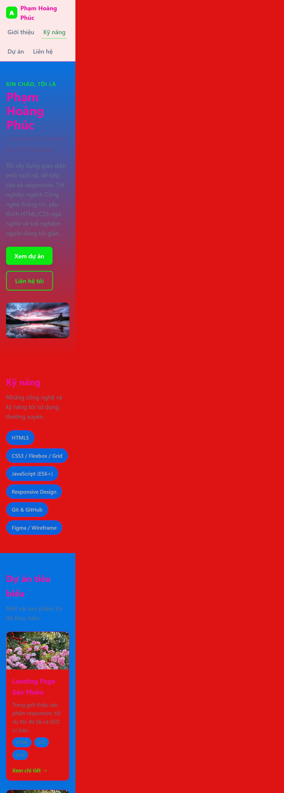
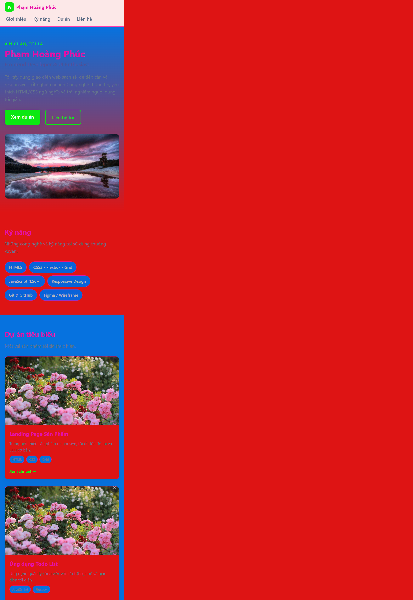

# BÁO CÁO KIỂM THỬ TRƯỚC KHI BÀN GIAO

## 1. Thông tin chung

| Thông tin | Giá trị |
|---|---|
| Tên dự án | Portfolio CV cá nhân của Phạm Hoàng Phúc |
| Phiên bản | v1.0 |
| Ngày kiểm thử | 05/11/2026 |
| Người thực hiện | [Điền họ tên] |
| Người đánh giá / xác nhận | [Điền họ tên] |
| Phạm vi | Website portfolio tĩnh: nội dung, điều hướng, giao diện, tài nguyên, khả năng vận hành và tài liệu bàn giao |
| Môi trường kiểm thử | [Điền hệ điều hành, trình duyệt và phiên bản; thiết bị/độ phân giải nếu có] |
| Kết luận hiện tại | Chưa đủ minh chứng kiểm thử để xác nhận sẵn sàng bàn giao |

> **Lưu ý:** Báo cáo này được khởi tạo từ thông tin trong repository và release note. Các mục chưa có kết quả hoặc minh chứng cần được kiểm tra, cập nhật trước khi ký xác nhận; không xem ô chưa chọn là kết quả Đạt.

### Quy ước trạng thái

- **Đạt:** Đã kiểm tra và đáp ứng yêu cầu; cần ghi lại minh chứng.
- **Chưa đạt:** Đã kiểm tra và xác nhận không đáp ứng; cần ghi lỗi hoặc bước tái hiện.
- **Cần cải thiện:** Có hạn chế, rủi ro hoặc điểm cần xác nhận/hoàn thiện trước khi bàn giao.
- Trong checklist, chọn đúng **một** trạng thái cho mỗi hạng mục và bổ sung minh chứng cụ thể.

## 2. Bảng tổng quan trạng thái

| # | Nhóm tiêu chí | Trạng thái | Tóm tắt / điểm cần lưu ý |
|---:|---|---|---|
| 1 | Tính đúng đắn và mức độ đáp ứng yêu cầu chức năng | Chưa đánh giá | Cần chạy kiểm thử chức năng và đối chiếu yêu cầu được duyệt. |
| 2 | Giao diện, trải nghiệm người dùng và khả năng tương thích | Chưa đánh giá | Cần kiểm tra trực quan trên các kích thước màn hình và trình duyệt mục tiêu. |
| 3 | Khả năng vận hành, xử lý lỗi và hiệu năng cơ bản | Chưa đánh giá | Cần kiểm tra tải trang, tài nguyên tĩnh, điều hướng và hành vi khi có lỗi. |
| 4 | Bảo mật, quản lý cấu hình và dữ liệu | Chưa đánh giá | Cần rà soát nội dung công khai, liên kết ngoài và cấu hình triển khai. |
| 5 | Chất lượng mã nguồn, cấu trúc repository và tài liệu bàn giao | Cần cải thiện | README mô tả dự án và cách chạy; cần xác nhận các thông tin/nội dung thực tế và hoàn thiện minh chứng kiểm tra. |
| 6 | Khả năng triển khai, kiểm thử và cung cấp minh chứng | Chưa đánh giá | README có hướng dẫn chạy tĩnh/Docker; chưa có kết quả chạy thử được ghi nhận trong báo cáo này. |

## 3. Nội dung kiểm thử chi tiết

### 3.1. Tính đúng đắn và mức độ đáp ứng yêu cầu chức năng

| Hạng mục kiểm tra | Trạng thái | Ghi chú / minh chứng cụ thể |
|---|---|---|
| Nội dung và các mục Giới thiệu, Kỹ năng, Dự án, Liên hệ hiển thị đầy đủ, đúng yêu cầu | [ ] Đạt · [ ] Chưa đạt · [ ] Cần cải thiện | Kiểm tra từng mục trên trang; đối chiếu yêu cầu đã duyệt. Ghi ảnh chụp hoặc đường dẫn minh chứng: [điền]. |
| Điều hướng đầu trang và các liên kết tới `#about`, `#skills`, `#projects`, `#contact` đưa tới đúng vị trí | [ ] Đạt · [ ] Chưa đạt · [ ] Cần cải thiện | Kiểm tra từng liên kết trên thanh điều hướng và các nút kêu gọi hành động; ghi kết quả: [điền]. |
| Thông tin cá nhân, kỹ năng, dự án và thông tin liên hệ chính xác, nhất quán | [ ] Đạt · [ ] Chưa đạt · [ ] Cần cải thiện | Đối chiếu nội dung hiển thị với dữ liệu được chủ dự án xác nhận: [điền]. |
| Liên kết email, GitHub, LinkedIn và các liên kết dự án hoạt động đúng mục đích | [ ] Đạt · [ ] Chưa đạt · [ ] Cần cải thiện | README ghi nhận các liên kết “Xem chi tiết” hiện là minh họa; cần thay bằng URL thật hoặc xác nhận rõ đây là nội dung mẫu trước bàn giao. Minh chứng: [điền]. |
| Nút và tương tác cơ bản (cuộn tới mục, cuộn mượt nếu được hỗ trợ) hoạt động | [ ] Đạt · [ ] Chưa đạt · [ ] Cần cải thiện | Kiểm tra thao tác chuột và bàn phím; ghi trình duyệt/kết quả: [điền]. |

### 3.2. Giao diện, trải nghiệm người dùng và khả năng tương thích

| Hạng mục kiểm tra | Trạng thái | Ghi chú / minh chứng cụ thể |
|---|---|---|
| Bố cục, màu sắc, kiểu chữ và khoảng cách nhất quán; không có nội dung chồng lấn hoặc bị cắt | [ ] Đạt · [ ] Chưa đạt · [ ] Cần cải thiện | Kiểm tra toàn trang ở các kích thước mục tiêu; đính kèm ảnh chụp: [điền]. |
| Giao diện responsive trên điện thoại (mobile), máy tính bảng (tablet) và máy tính (desktop) | [ ] Đạt · [ ] Chưa đạt · [ ] Cần cải thiện | Đã chụp ảnh màn hình trang bằng trình duyệt ở các viewport mobile 390×844, tablet 768×1024 và desktop 1440×900; ảnh đầy đủ được lưu và liên kết bên dưới. Xem ảnh để đối chiếu bố cục, nội dung bị cắt/chồng lấn và điều hướng; xác nhận kết quả trên thiết bị thực nếu nằm trong phạm vi kiểm thử. |

**Minh chứng ảnh chụp responsive** (viewport trình duyệt mô phỏng):

| Mobile (390×844) | Tablet (768×1024) | Desktop (1440×900) |
|---|---|---|
| [responsive-mobile.png](./screenshots/responsive-mobile.png) | [responsive-tablet.png](./screenshots/responsive-tablet.png) | [responsive-desktop.png](./screenshots/responsive-desktop.png) |

| Hiển thị và điều hướng nhất quán trên Chrome, Edge, Firefox và Safari (nếu thuộc phạm vi hỗ trợ) | [ ] Đạt · [ ] Chưa đạt · [ ] Cần cải thiện | Ghi phiên bản trình duyệt, kết quả và khác biệt quan sát được: [điền]. |
| Ảnh có tải đúng, đúng nội dung, không méo; văn bản thay thế phù hợp | [ ] Đạt · [ ] Chưa đạt · [ ] Cần cải thiện | Kiểm tra ảnh đại diện và ảnh dự án; ghi lỗi hoặc ảnh chụp: [điền]. |
| Có thể nhận biết nội dung, trạng thái liên kết và vùng điều hướng bằng phương thức sử dụng phù hợp | [ ] Đạt · [ ] Chưa đạt · [ ] Cần cải thiện | Kiểm tra khả năng đọc, tương phản cơ bản, focus bàn phím và nhãn điều hướng; kết quả: [điền]. |

### 3.3. Khả năng vận hành, xử lý lỗi và hiệu năng cơ bản

| Hạng mục kiểm tra | Trạng thái | Ghi chú / minh chứng cụ thể |
|---|---|---|
| Trang mở được trực tiếp hoặc qua máy chủ web tĩnh theo hướng dẫn bàn giao | [ ] Đạt · [ ] Chưa đạt · [ ] Cần cải thiện | README hướng dẫn mở `index.html` hoặc chạy máy chủ cục bộ; ghi cách chạy đã thử và kết quả: [điền]. |
| CSS và toàn bộ ảnh/tài nguyên được tải thành công, không có lỗi đường dẫn | [ ] Đạt · [ ] Chưa đạt · [ ] Cần cải thiện | Kiểm tra Network/Console của trình duyệt; liệt kê lỗi nếu có: [điền]. |
| Tải lại trang và truy cập trực tiếp các liên kết neo không làm trang rơi vào trạng thái lỗi | [ ] Đạt · [ ] Chưa đạt · [ ] Cần cải thiện | Ghi các bước và kết quả: [điền]. |
| Trang phản hồi ổn định trong lượt sử dụng thông thường; không có lỗi JavaScript hoặc lỗi hiển thị nghiêm trọng | [ ] Đạt · [ ] Chưa đạt · [ ] Cần cải thiện | Ghi Console và tình huống kiểm tra: [điền]. |
| Thời gian tải và kích thước tài nguyên ở mức phù hợp cho website tĩnh | [ ] Đạt · [ ] Chưa đạt · [ ] Cần cải thiện | Đo trong môi trường ghi ở phần Thông tin chung; ghi công cụ, số liệu và ngưỡng chấp nhận: [điền]. |

### 3.4. Bảo mật, quản lý cấu hình và dữ liệu

| Hạng mục kiểm tra | Trạng thái | Ghi chú / minh chứng cụ thể |
|---|---|---|
| Không đưa khóa bí mật, thông tin xác thực, dữ liệu nhạy cảm hoặc dữ liệu cá nhân không được phép lên repository/trang công khai | [ ] Đạt · [ ] Chưa đạt · [ ] Cần cải thiện | Rà soát mã nguồn và nội dung được xuất bản; ghi phạm vi rà soát: [điền]. |
| Thông tin cá nhân hiển thị và thông tin liên hệ đã được chủ dự án xác nhận cho phép công khai | [ ] Đạt · [ ] Chưa đạt · [ ] Cần cải thiện | Xác nhận với chủ dự án; ghi người xác nhận/ngày: [điền]. |
| Liên kết ngoài trỏ tới đúng tên miền, không dẫn tới URL không mong muốn hoặc nội dung mẫu chưa được xử lý | [ ] Đạt · [ ] Chưa đạt · [ ] Cần cải thiện | Kiểm tra email, GitHub, LinkedIn và liên kết dự án; README ghi nhận liên kết dự án minh họa cần được thay thế hoặc xác nhận. |
| Cấu hình triển khai không để lộ thư mục, tệp hoặc thông tin không thuộc phạm vi phát hành | [ ] Đạt · [ ] Chưa đạt · [ ] Cần cải thiện | Rà soát nội dung được phục vụ bởi máy chủ tĩnh/Docker; ghi cấu hình và kết quả: [điền]. |
| Việc lưu trữ và xử lý dữ liệu phù hợp với phạm vi sản phẩm | [ ] Đạt · [ ] Chưa đạt · [ ] Cần cải thiện | Sản phẩm được mô tả là website tĩnh, không có backend hoặc cơ sở dữ liệu; xác nhận bản phát hành thực tế không bổ sung xử lý dữ liệu ngoài mô tả. |

### 3.5. Chất lượng mã nguồn, cấu trúc repository và tài liệu bàn giao

| Hạng mục kiểm tra | Trạng thái | Ghi chú / minh chứng cụ thể |
|---|---|---|
| Cấu trúc repository rõ ràng, có các tệp cần thiết và đường dẫn tài nguyên nhất quán | [ ] Đạt · [ ] Chưa đạt · [ ] Cần cải thiện | Đối chiếu `index.html`, `assets/css/`, `assets/img/` và tài liệu; ghi thiếu sót nếu có: [điền]. |
| HTML có cấu trúc hợp lý, ngôn ngữ trang và thông tin metadata phù hợp | [ ] Đạt · [ ] Chưa đạt · [ ] Cần cải thiện | Rà soát HTML và xác minh nội dung thực tế; ghi kết quả/lỗi: [điền]. |
| CSS dễ bảo trì, có bố cục responsive và không phát sinh lỗi hiển thị do thay đổi | [ ] Đạt · [ ] Chưa đạt · [ ] Cần cải thiện | Rà soát stylesheet và kiểm tra trên các kích thước mục tiêu; minh chứng: [điền]. |
| README mô tả đúng chức năng, công nghệ, yêu cầu môi trường, cấu trúc và cách chạy | [ ] Đạt · [ ] Chưa đạt · [ ] Cần cải thiện | README hiện mô tả website HTML/CSS tĩnh và hướng dẫn chạy cục bộ/Docker; đối chiếu với bản phát hành thực tế: [điền]. |
| Release note nêu đúng phiên bản, thay đổi và hạn chế còn tồn tại | [ ] Đạt · [ ] Chưa đạt · [ ] Cần cải thiện | `docs/RELEASENOTE.md` ghi phiên bản v1.0, ngày 05/11/2026 và các hạn chế; xác nhận phù hợp với bản được bàn giao: [điền]. |
| Không còn nội dung mẫu, thông tin sai hoặc ghi chú nội bộ ngoài ý muốn trong sản phẩm/tài liệu | [ ] Đạt · [ ] Chưa đạt · [ ] Cần cải thiện | README/release note đề cập nội dung dự án và liên kết minh họa; xác nhận đã thay thế hoặc được chủ dự án chấp thuận: [điền]. |

### 3.6. Khả năng triển khai, kiểm thử và cung cấp minh chứng

| Hạng mục kiểm tra | Trạng thái | Ghi chú / minh chứng cụ thể |
|---|---|---|
| Làm theo hướng dẫn triển khai trong README trên môi trường mục tiêu và mở được trang | [ ] Đạt · [ ] Chưa đạt · [ ] Cần cải thiện | Ghi môi trường, lệnh/cách triển khai, URL hoặc vị trí chạy và kết quả: [điền]. |
| Nếu dùng Docker, container khởi động, phục vụ đúng nội dung và dừng được theo hướng dẫn | [ ] Đạt · [ ] Chưa đạt · [ ] Cần cải thiện | README hướng dẫn chạy Nginx với `nginx:alpine`; kiểm tra trên máy có Docker và ghi kết quả/log: [điền]. |
| Có danh sách ca kiểm thử và kết quả thực thi có thể đối chiếu | [ ] Đạt · [ ] Chưa đạt · [ ] Cần cải thiện | Đính kèm đường dẫn tới log, danh sách ca kiểm thử hoặc kết quả chạy: [điền]. |
| Có minh chứng trực quan cho giao diện responsive và các lỗi đã phát hiện (nếu có) | [ ] Đạt · [ ] Chưa đạt · [ ] Cần cải thiện | Đã lưu 3 ảnh chụp viewport trình duyệt trong `docs/screenshots/`: `responsive-mobile.png` (390×844), `responsive-tablet.png` (768×1024), `responsive-desktop.png` (1440×900). Bổ sung ảnh thể hiện lỗi nếu phát hiện vấn đề: [điền]. |
| Các lỗi chưa xử lý có mức độ, người phụ trách và quyết định chấp nhận rủi ro rõ ràng | [ ] Đạt · [ ] Chưa đạt · [ ] Cần cải thiện | Liệt kê mã lỗi, mức độ, trạng thái và người phê duyệt ngoại lệ: [điền]. |

## 4. Đánh giá tổng kết và đề xuất

### Nhận định chung

Repository mô tả một website portfolio/CV tĩnh, có các mục Giới thiệu, Kỹ năng, Dự án và Liên hệ; README cung cấp hướng dẫn chạy bằng trình duyệt, máy chủ tĩnh và Docker. Tuy nhiên, báo cáo này chưa ghi nhận kết quả chạy thử hoặc minh chứng kiểm thử thực tế. Vì vậy, **chưa thể xác nhận sản phẩm sẵn sàng bàn giao chỉ dựa trên báo cáo hiện tại**.

Release note nêu rõ các liên kết “Xem chi tiết” còn là liên kết minh họa và một số nội dung dự án chỉ mang tính giới thiệu. Trước khi phát hành, cần thay thế bằng nội dung/liên kết chính xác hoặc được chủ dự án xác nhận chấp thuận giữ nguyên.

### Vấn đề cần xử lý hoặc xác nhận trước bàn giao

| # | Vấn đề / hành động | Mức độ | Người phụ trách | Hạn hoàn thành | Trạng thái |
|---:|---|---|---|---|---|
| 1 | Thay các liên kết dự án minh họa bằng URL hợp lệ hoặc xác nhận rõ việc giữ nội dung mẫu. | [Cao / Trung bình / Thấp] | [Điền] | [Điền] | [Mở / Đang xử lý / Đã xử lý / Chấp nhận rủi ro] |
| 2 | Xác nhận tính chính xác và quyền công khai của thông tin cá nhân, mô tả dự án và thông tin liên hệ. | [Cao / Trung bình / Thấp] | [Điền] | [Điền] | [Mở / Đang xử lý / Đã xử lý / Chấp nhận rủi ro] |
| 3 | Hoàn tất các hạng mục chưa kiểm thử; lưu kết quả và ảnh minh chứng vào repository. | [Cao / Trung bình / Thấp] | [Điền] | [Điền] | [Mở / Đang xử lý / Đã xử lý / Chấp nhận rủi ro] |

### Đề xuất quyết định bàn giao

- [ ] **Sẵn sàng bàn giao:** Các hạng mục bắt buộc đều Đạt; lỗi còn lại đã được phê duyệt chấp nhận.
- [ ] **Sẵn sàng bàn giao có điều kiện:** Có danh sách vấn đề, người phụ trách, thời hạn và phê duyệt ngoại lệ rõ ràng.
- [ ] **Chưa sẵn sàng bàn giao:** Còn lỗi nghiêm trọng hoặc thiếu minh chứng/kiểm thử bắt buộc.

**Điều kiện hoặc lý do của quyết định:** [Điền kết luận, lỗi còn mở và ngoại lệ được phê duyệt.]

| Xác nhận | Họ tên | Ngày | Chữ ký / xác nhận |
|---|---|---|---|
| Người thực hiện kiểm thử | [Điền] | [Điền] | [Điền] |
| Người đánh giá | [Điền] | [Điền] | [Điền] |
| Đại diện bàn giao / chủ dự án | [Điền] | [Điền] | [Điền] |